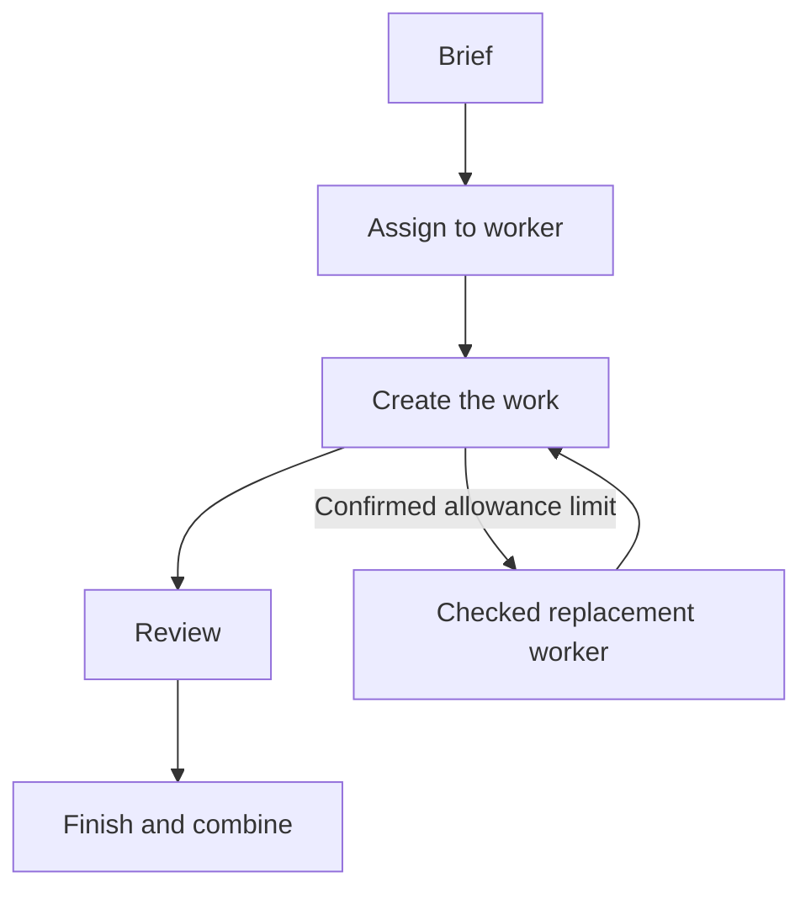

# How a Team of AI Workers Shares a Project

Codex coordinates the project. Ready workers such as Claude or Grok can own code, tests, documentation or presentation pieces. Codex chooses workers that fit the task and are available.

Before a task starts, it passes an allowance check and is given a firm deadline. Another worker may review the result, and Codex then checks and combines whatever is accepted.

If a worker reaches a confirmed allowance limit, the task can move to a suitable back-up worker, who goes through the same allowance check. Available unfinished answer text is saved. If it is unclear whether a task actually ran, it is flagged for inspection rather than repeated.

The first attempt freezes the brief, ordered workers and selected Claude/Codex
model settings. Repeating the same project and assignment uses those saved model
settings when no explicit model override is supplied. Changing the default Claude
model or the Codex lead switch therefore does not strand an existing assignment
or replace its saved result. An explicit different model still requires a new
assignment or deliberate revision.

Current paused-model restrictions remain enforced on resume. An unsupported saved
Codex model is held for review. Unknown completion retains the original job and
reservation; a preference change cannot trigger a duplicate attempt or advance
to another provider. Provider aliases such as `opus` remain aliases: the saved
selector is not proof of an immutable vendor model version. Inspect returned
model metadata when exact reproducibility matters.

Work-share percentages are rough estimates of accepted contributions. They are not a bill, and they do not track cost or remaining allowance.

